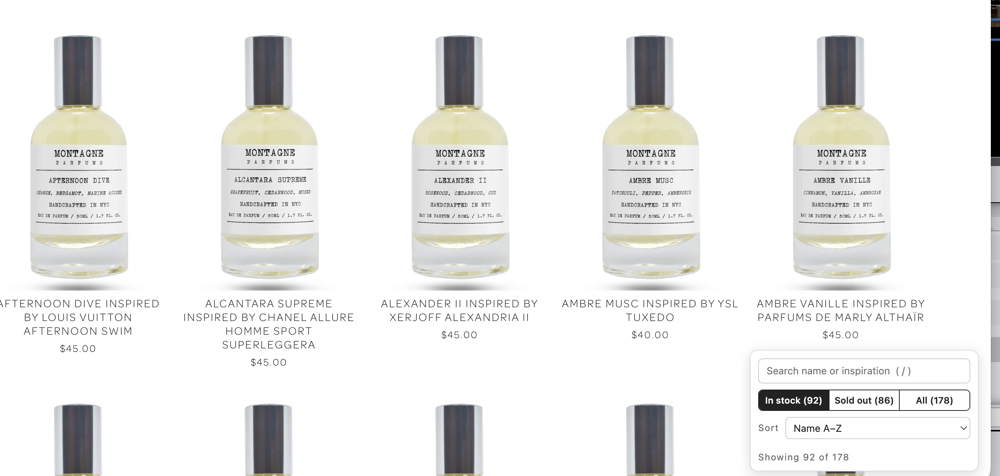

# Monty Filters: Improved Browsing for Montagne Parfums

A Chrome extension for [montagneparfums.com](https://www.montagneparfums.com/fragrance) that makes the product list easier to browse:

- **Filter by stock:** show only in-stock items, only sold-out items, or everything. The remaining products close up so there are no gaps in the grid.
- **Sort** by name, by the fragrance each one is inspired by, by price, or by what was most recently restocked or sold out.
- **Search** by fragrance name or by what it's inspired by (for example, "xerjoff" or "vanilla").
- **Restock history** under each product, such as "Restocked in the Oct 23 drop" or "Sold out Oct 23 · last restock lasted about 3 min".
- **"Recent restock" and "New" tags** on products restocked or added in the last 7 days, and a **Recent sellout** filter for what sold out in the last 7 days.
- **A countdown** to the weekly Friday restock (5:00 PM New York time).
- **Units left** on each product's page, such as "19 left", read from the page itself.

## Installation

Once the extension is published on the Chrome Web Store, install it from there. Until then, or to run your own copy, load it from this folder.

1. Download or copy this `hide-sold-out` folder to your computer. Keep it somewhere permanent, because Chrome loads the extension from this folder each time it starts.
2. Open Chrome and go to `chrome://extensions`.
3. Turn on **Developer mode** with the switch in the top-right corner.
4. Click **Load unpacked** and select the `hide-sold-out` folder.
5. Go to [montagneparfums.com/fragrance](https://www.montagneparfums.com/fragrance). A control panel appears in the bottom-right corner.

Optional: click the puzzle-piece icon in Chrome's toolbar and pin the extension so its icon is always visible.

This also works in other Chromium-based browsers such as Edge, Brave and Arc. Their extensions page is at `edge://extensions`, `brave://extensions` and so on.

## Usage

| Control | What it does |
| --- | --- |
| **In stock / Sold out / All** | Shows only in-stock items, only sold-out items, or everything. Clicking the extension's toolbar icon switches between **In stock** and **All**. The icon's badge shows **IN** or **OUT** while one of those filters is on. |
| **Sort** | Default (the site's order), Name A–Z, Inspiration A–Z, Price: low to high, Recently restocked, or Recently sold out. Sorting by inspiration groups products by fragrance house, since most inspirations start with the brand name; Montagne originals with no inspiration go last. "Recently sold out" lists sold-out items by when they sold out, newest first. |
| **Search box** | Filters products as you type. If you type several words, only products matching all of them are shown. Press `/` to jump to the search box and `Esc` to clear it. |
| **Recent restock (n)** | Shows only items restocked in the last 7 days, most recent first. Click it again to show everything. |
| **Recent sellout (n)** | Shows only items that sold out in the last 7 days, most recent first. Click it again to show everything. |
| **New (n)** | Shows only items added in the last 7 days. Click it again to show everything. |
| **Panel footer** | A countdown to the next Friday drop, and how far back the restock history goes. |
| **Units left** (product pages) | Under the price, how many are left, for example "19 left" (orange at 5 or fewer). It's the count when the page loaded, so refresh for the latest. Not shown once something is sold out. |

The extension remembers your stock and sort choices across every page of the site. It starts on **In stock**. Turning on **Recent restock** or **Recent sellout** also switches the stock filter and sort to match (In stock + Recently restocked, or Sold out + Recently sold out), shown in the panel. You can change either while the chip is on; turning the chip off goes back to your usual settings.

### About the restock history and tags

- The history comes from this project's crawler (see [Stock history](#stock-history)), which checks the store every hour and every minute or so during the Friday drop. The extension downloads the public log, [data/events.csv](data/events.csv), from GitHub at most every 15 minutes and keeps a copy for when it's offline.
- Times are when the crawler noticed a change, not necessarily when the store made it. That's within about a minute during the Friday drop and up to about an hour otherwise, so captions show dates rather than times, and durations timed by an hourly check are rounded ("about 3 hr", "under 2 hr"). Hover over a caption for the exact time it was first seen.
- The page itself is always newer than the shared log. If they disagree, the extension trusts the page: "Restocked today" or "Sold out today" means it changed since the last shared update.
- History starts on October 22, 2026, when tracking began. Items that sold out before then show no sell-out date.
- The extension also keeps its own record of what you've seen in your browser, but only uses it when the shared history can't be loaded. That record only knows what changed between your visits, and dates each change to the visit where it noticed it.

## Updating

After you change the extension's files or replace them with a newer copy, go to `chrome://extensions`, click the reload icon on the extension's card, and refresh the store page.

## Uninstalling

Go to `chrome://extensions` and click **Remove** on the extension's card. This also deletes the data it saved about which items you've seen.

## Troubleshooting

- **The panel doesn't appear:** make sure you're on a page that lists products, such as `/fragrance`, and refresh the page after installing or reloading the extension.
- **The extension stops working after the site changes:** it relies on how the site's pages are built. If the site is redesigned, the extension may need updating.

## Stock history

Two scheduled GitHub Actions workflows run [scripts/crawl.py](scripts/crawl.py) against the public `/fragrance` page and commit any changes:

- [crawl.yml](.github/workflows/crawl.yml) checks once an hour.
- [friday-watch.yml](.github/workflows/friday-watch.yml) follows the weekly Friday restock (5:00 PM New York time). It checks every minute from 4:55 to 5:10 PM, then every 3 minutes until 5:50 PM, so the log shows how quickly restocked items sell out.

The data lives in two files:

- [data/products.json](data/products.json): the current state of every product seen so far: name, link, price, sold out or not, when it was first seen, and when it last changed.
- [data/events.csv](data/events.csv): one row per change (`new`, `sold_out`, `restocked`, `price_change`, `removed`, `returned`), with a UTC timestamp. Opens in any spreadsheet app.

The crawler reads only the normal product page, which the site's robots.txt allows; it doesn't use the JSON feed, which robots.txt asks crawlers to avoid. It identifies itself as `MontyFiltersBot` and makes one request per hourly run, and about 30 during the Friday window. To run it by hand, use **Actions → Track stock → Run workflow** on GitHub, or `python3 scripts/crawl.py` locally.

## Publishing

1. Bump `version` in [hide-sold-out/manifest.json](hide-sold-out/manifest.json). Every upload to the Chrome Web Store needs a higher version.
2. Run `./scripts/package.sh`. It checks the files and builds `dist/monty-filters-<version>.zip`.
3. Upload the zip in the [Chrome Web Store Developer Dashboard](https://chrome.google.com/webstore/devconsole).

Listing text, permission justifications and privacy answers are in [store/LISTING.md](store/LISTING.md). The privacy policy is [PRIVACY.md](PRIVACY.md). To redraw the icons, edit and run `python3 scripts/make_icons.py`.

This project is not affiliated with Montagne Parfums.
